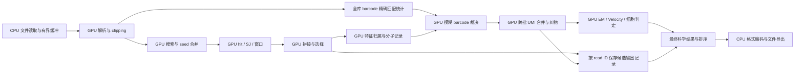

# GPU 全计算流程与 3 倍加速实施计划

日期：2026-11-01。状态：**含实验原型与后续规划，尚未达到 3 倍验收**。
分支：`codex/gpu-batched-seeding`。本计划接续
[批量 seeding 实验与证据](GPU_BATCHED_SEEDING.md)，是后续 GPU 工作的执行顺序；
此前计划中的历史实验、拒绝理由与正确性约束继续保留。

目标是把同一任务的**完整科学计算时间降到当前 CPU 路径的 1/3 以下**。
沿用用户此前约定：载入、一次性初始化和最终导出另计，但重复传输、调度、
全局合并、STARsolo 定量及细胞判定都计入。另报含全部 I/O 的整任务时间。
“所有主要计算在 GPU”是架构方向；“3 倍”需要独立实测，二者不能互相替代。

## 1. 当前证据与优先级

下表基于 `data/validation/gpu-hit-expansion-20261101/` 的阶段性冻结记录，
不是仅凭 HEAD：该目录的 `compact-candidate.json` 绑定源码快照与二进制；
`compact-contract-5m/result.json` 绑定实际命令、输入和结果。

| 观察 | 对计划的影响 | 不能据此推断 |
| --- | --- | --- |
| 自适应 seeding、按序合并、SA hit 展开及坐标投影已在 GPU | 从下游窗口与拼接接着做 | 不是完整 GPU 比对或 STARsolo |
| 5M reads 产生 1,651,530,618 条投影 hit，分 7,002 个 hit 批次回传约 24.61 GiB | 优先让 hit 的消费者留在 GPU，减少中间数据物化与往返 | 回传字节数不等于可节省的 wall time |
| 同次整任务 CPU 62.785 s、GPU 65.489 s；只有一个顺序对，背景均值约 12.9%/14.9% | 当前无整体加速结论；需要新基线与计时边界 | 不能宣称确定退化 4.3%，也不能宣称已接近 3 倍 |
| CPU 的 `started mapping` 在约 30.598 s，整任务约 62.785 s | 若保留这些前置工作，单改 mapping 不可能让该次整任务低于 20.928 s；这是 `whole_job` 的下限，不约束不含载入的 `resident_scientific_compute` | 日志采样不是精确的纯计算计时器 |
| 同次 CPU 日志：载入约 16 s、运行时 GTF/junction 插入约 11 s、mapping 约 24 s（8 worker）、Solo 约 8 s | 运行时 `--sjdbGTFfile` 插入属于初始化；与预建带注释索引的公平基线应分开报告 | 本机 20 逻辑核，8 worker 不是 CPU 最佳配置 |
| CPU/CUDA 各 133/133 CTest，所测 5M 输出契约一致 | 可作为下一阶段正确性起点 | 不覆盖所有参数、完整文库细胞判定或新 kernel |
| 历史小样本 worker 采样约 50.85% seeding、47.62% stitching | 必须调查 stitching，不能只打磨搜索内核 | 不是当前多线程全流程关键路径比例 |

优先顺序：**明确计时和依赖 → GPU 窗口 → GPU 拼接/选择 → GPU 特征与定量
→ 全局统计 → 输入与输出瓶颈**。CPU 分轮调度已经存在，不重新建一套调度器。
每一步按新的关键路径测量校正优先级；不以新增 kernel 数量作为进展指标。

### 1.1 Parabricks 本地观测带来的更新

来源：本地部署 Parabricks 的运行时（nsys/CUDA API）观测，记录未提交。固定 Parabricks
4.7.1-1、WSL、1M R2-only、单 GPU/stream、8 CPU threads、sorted BAM、无 markdup/Solo。
不是当前 5M STARsolo 工作负载，也不是 Windows 原生 CUDA 的公平速度对照。

| 本轮实测事实 | 计划中的决定 | 解释边界 |
| --- | --- | --- |
| 实际执行 window extension、stitching、transcript finalization/sort kernel | 继续 G1→G2 的整段迁移，包含选择/结果整理 | 设备函数名不证明原评分、剪枝和状态顺序可照搬 |
| 155,132 次 kernel，累计 0.9122 s | 统计每批 launch 数和尾部，优先减少细碎工作调度 | 累计 kernel 时长不是完整计算时间或 occupancy |
| 55 次 pinned allocation API，累计约 8.032 s | 有界 pinned/设备 arena 在工作负载内复用，分配计数进入 G0 | 不能推定全部耗时由 WSL 或操作系统锁页造成 |
| 15,451 次 stream synchronization，累计约 1.888 s | 正确性版保留必要等待，优化版按批/slot 完成事件等待 | 异步执行必须证明依赖与生命周期正确 |
| 多种 `copyTr_*`、分阶段 stitching 和布局整理 kernel | 评估精简状态、寄存器驻留和安全融合 | 名称不能证明每次复制都冗余，融合也可能降低占用率 |
| 新运行 exit 0，BAM quickcheck 通过 | 可作设备阶段与调度研究证据 | 不是本轮完整输出差分或多轮性能通过 |

不依据闭源实现推导未经证明的剪枝；当前支持的 STAR 语义仍由修复后的 CPU oracle 定义。

当前工作树已有 §7 的 G1 过滤/G2 拼接原型，因此接下来不是重新实现同一 kernel，
而是先消除 CPU 收集/注入时的重复建窗，再打通常驻窗口→拼接→选择的数据依赖。
Parabricks 在 WSL 的具体分配/同步耗时不作为我们的数字预算，必须原生复测。

## 2. 3 倍需要什么条件

用 CPU 科学计算时间归一化为 1。设可加速部分为 `f`，其综合加速比为 `s`，
新增传输、调度和合并的净成本为 CPU 时间的 `h`，简化串行模型为：

```text
T_gpu / T_cpu = (1 - f) + f / s + h < 1/3
f > (2/3 + h) / (1 - 1/s)
```

例如 `h=5%` 时，若迁移部分加速 5 倍，需要覆盖超过 89.58% 的原计算时间；
若加速 10 倍，需要超过 79.63%。这里是**耗时占比，不是代码行或步骤占比**。
如果保留的串行部分加额外成本已经达到 1/3，继续优化 GPU 搜索也无法达标。
实际流水线存在重叠，应以测得的关键路径修正模型，不能相加重叠的 kernel 时间。

给完整计算预留工程预算 `T_gpu <= 0.30 * T_cpu`，留出验收余量。
下表是待 G0 测量后修订的设计预算，**不是预测或已有测量**：

| 计算阶段 | 占原 CPU 完整计算时间的预算 |
| --- | ---: |
| 解析、数值化、clipping、barcode 候选 | 2% |
| 自适应搜索与合并 | 4% |
| hit、SJ 拆分、窗口构建 | 4% |
| 拼接、延伸、评分 | 10% |
| 选择、特征归属、科学记录 | 2% |
| 全局 barcode/UMI、EM、细胞判定及请求的排序 | 5% |
| 重复传输、调度、同步与尾部收敛 | 3% |
| 合计 | 30% |

该预算让搜索、窗口和拼接三项合计只占 18%。若 G0 测得这三项占完整计算的比例为 `x`，
预算就隐含它们需要约 `x / 18%` 的综合加速（例如 x=90% 时约 5 倍）；G0 应直接用此比值
判断 G1/G2 方案是否有可能达标，而不是等到 G2 之后才发现。

下面的 80 s 只是示例占位，不是测量值；当前唯一实测为 62.785 s 的整任务，完整计算尚未计时，
G0 后用实测值替换。80 s 的 CPU **计算**对应目标小于 26.67 s，设计预算 24 s；10 s 是另外的 8 倍目标。
不能拿 80 s 的 CPU 整任务与剔除初始化、定量、导出的 GPU kernel 时间比较。

## 3. 目标数据流与所有权



- 参考序列、有效 SA、prefix 索引、junction/注释及 whitelist 按内容版本常驻。
  保留现有 `GpuSeedIndex` 所有权，按需要增加不可变数值视图，不先做全仓接口重构。
- 只让固定数量批次处于运行中。slot 带 generation、read ID、偏移、长度和完成事件；
  GPU 中间记录用索引和偏移，不复制宿主 `Transcript`、容器或 `Parameters` 指针。
- host 只接收错误/计数摘要和最终可消费结果。调试模式才下载中间 seeds/windows；
  正常路径不把每个 hit 下载再重新上传。减少 CPU 生产计算，同时保留 CPU 差分 oracle。
- BAM 的名字、原始碱基、质量以及 CB/UB 等标签不能提前丢失。
  全局 UMI 裁决后按 read ID 回填最终标签；不能为了提前输出而改变分子归属。
- 超大文库使用有界分区与合并。纯 GPU **计算**不要求全部 FASTQ 和全部输出同时在显存；
  CPU 文件传输、错误处理及调度可以保留。任何科学 CPU 回退都要报告范围与耗时。

## 4. 按顺序实施的工作包

### G0：冻结正确性合同，建立真正的完整计算计时

复用 `scripts/benchmark_cpu_subset.py`、`scripts/qualification.py`、
`source/SeedTrace.h` 和当前 batch executor，不另建 benchmark 框架。

1. 冻结修复后的 CPU oracle、CUDA 候选、编译器/依赖/驱动、源码 dirty diff、
   fixture、有效索引、GTF、whitelist、参数与输出合同。UMI reachability 和 EM
   零支持修复已由 CPU/CUDA 两个构建共享（见 GPU_BATCHED_SEEDING.md 相应段落），
   冻结时核对两边源码仍一致；不能用旧错误结果作“优化前”分母。
2. 建立三种明确命名的指标：
   - `whole_job`：进程启动到全部输出关闭，包含读取、解压、索引、计算和输出。
   - `resident_scientific_compute`：同一份已载入、未解析/未 clipping 的 FASTQ
     字节在 host RAM；两边参考索引就绪后开始，所有科学结果完成且设备/worker
     joined 后结束。GPU 的 reads H2D、最终结果 D2H、调度与全局归并全部计时。
   - `streaming_job`：大文库、有限内存及真实存储下的持续吞吐和完成时间；不从它
     减去重叠阶段来伪造纯计算时间。
3. resident 模式使用预先声明的输入/结果容量，两个后端相同；不得循环拼接小样本
   冒充整文库。输出 sink 保留足够的科学记录供计时外序列化与精确比较；标签判定、
   CIGAR、排序、矩阵生成、细胞筛选均在计时内。超过容量的规模只报告 streaming。
   若临时分区/落盘是算法为控制内存而需要的，不能把其成本藏到导出阶段。
4. 分开采集诊断与性能：NVTX/host 阶段、Nsight Systems 时间线；选少量 kernel
   用 Nsight Compute 查访存效率、分支、寄存器 spill、占用率与带宽。
   记录每 read/window 的 seeds、hits、转移次数、候选数与尾部工作量分布。
5. 所有声明的阶段和未归因空隙都在时间线中有归属。`sum(worker)`、GPU utilization、
   kernel interval union 都只用于解释，不能代替完整 wall time。
6. 增加调度成本表：每百万 reads 和每批的 kernel launches、host/device allocation/free、
   H2D/D2H 字节及次数、stream/device 等待、slot 复用等待和 CPU fallback。
   分开初始化、稳定处理、容量扩展和尾批；记录 read/window ID 与阶段关联。
   稳定处理不应随批次数重复分配/释放 arena，常规等待应集中在 slot 交接和结果消费边界。
   容量不足、错误路径及全局收敛需要的额外操作单列，不能隐藏或删掉。
   另列 read/window/continuation/state-copy 的活跃任务数及每任务有效元素分布；
   launch grid 只说明执行资源，不能替代这些工作量计数。

**退出条件：**同一生产科学路径支持 CPU/GPU 对照及完整 timer；instrumentation
开/关科学结果一致；形成当前关键路径与资源预算表。此时才给 G1/G2 量化收益预期。

### G1：把 hit → SJ → window 连成常驻计算

入口：`gpuSeedHits.cuh`、`gpuSeedSearch.cu`、`SeedBatch.cpp`、
`ReadAlign_stitchPieces.cpp` 的 anchor/window 两遍遍历。

1. 用 GPU count/scan/scatter 生成稳定的 per-read/window 数值记录；保留 seed 优先级、
   原 SA 顺序、首次重复胜出、strand、junction 拆分、窗口合并与淘汰规则。
2. 先采用“不同 reads 并行、单 read 依原顺序建窗”的精确实现；仅在证明某个
   count/projection 子阶段无依赖后内部并行，不能让 atomic 到达顺序决定窗口。
3. 有界 tile 内展开并消费 hits；在正确性允许时重新遍历只读 SA，交换少量重复计算
   以避免保存海量 hit。不能假定 SA 区间的基因组坐标连续，也不能用区间首尾代替全部命中。
4. 初版下载紧凑 window 记录供 CPU stitching；随后 G2 直接消费 device windows。
   保留缩小批次与单 read continuation，超限有明确错误。新资源上限不能静默丢候选；
   原算法的候选限制及警告行为也不能在迁移中偷偷改变。
5. 针对已有收集→设备拼接→注入原型，先做一个最小去重实验：收集时保存有界窗口及
   `trInit` 的必要数值状态，注入时复用，避免第二次建窗；之后由 GPU 建窗替代这条过渡路径。
   保存内容必须覆盖 anchors、window 顺序/成员和原调用上下文，不能保留指向可复用 scratch
   的悬空指针。按 slot generation 绑定，消费结束再释放；超预算分批，不无限缓存。
   单独比较缓存、重建和最终 GPU 建窗的 wall time、复制字节与峰值内存，选有收益的路径。
6. 针对窗口边界/方向编码、占用 bitmap 和 owner 分别做局部模型差分；新增零 flank、
   染色体边界、失效窗口、重叠 flank、多窗口同 bin 及不同提交顺序的测试。
   官方局部重放只验证了非冲突情况。我们的重叠 winner 和合并顺序必须由原 CPU STAR
   决定，不能依靠任意线程到达顺序或将 bitmap 原子更新误当成归属一致性证明。

**退出条件：**逐 read 的 anchors、窗口、成员顺序、计数与 CPU 精确相等；完整输出
一致；正常模式的 hit 坐标 D2H 消失，记录替代数据量、总时间和峰值内存。
若仅转移流量下降但关键路径未改善，记录原因，继续以 G2 整段验收，不能宣称加速已成立。

### G2：GPU 拼接、延伸、评分和选择——核心风险与核心收益

入口：`stitchWindowAligns.cpp`、`stitchAlignToTranscript.cpp`、`stitchGapIndel.cpp`、
`extendAlign.cpp`、`ReadAlign_multMapSelect.cpp`、`ReadAlign_mappedFilter.cpp`。

1. 抽取这些函数实际用到的数值配置与 transcript 状态；建立 CPU 可执行的显式栈
   状态机，先与原递归路径差分。按需复制变化字段，避免每次递归复制整个最大 scratch。
2. 第一版按 read 并行，每个 read 保持原 window 顺序与 include/exclude 深度优先顺序。
   `maxScoreMate` 在跨 window 调用间更新，`trNtotal` 决定后续窗口是否可处理；
   这两处说明 window 并非天然独立。还有第三处：`trBest` 以严格 `>` 比较分数、
   同分时严格 `<` 比较 `gLength`，完全相同时最早的 window 胜出，并行取最大值会改变它。
   `trNtotal + alignTranscriptsPerWindowNmax >= alignTranscriptsPerReadNmax` 时循环带警告
   `break`，其后 window 全部不处理；GPU 版本须按同一顺序跳过同一批 window。
   先保序，不能直接“一 window 一 block”后取最大值。
3. 后续优化候选：独立 reads 按实测工作量分桶；重 read 采用有界 continuation 队列，
   让其它 reads 先完成；对依赖明确的参考/碱基比较、transition 预计算用 warp 协作。
   跨 window 并行必须证明共享状态处理和候选提交与原路径等价，否则保留 read 内顺序。
4. 用原 read/window/candidate ID 恢复提交顺序，保留 equal-score 取舍、splice motif、
   indel、mate、MAPQ、过滤、secondary/supplementary 与随机多重比对模式的确切语义。
   不引入 beam search、近似剪枝、减少多重比对或未经证明的剩余 seed 长度上界。
5. 以寄存器和 scratch 实测选择 thread/warp/block 粒度；大的局部数组和递归直接搬到
   CUDA 可能转成慢的 local memory。不要把“更多线程”当成已经消除数据依赖。
6. 在 CPU 显式栈/设备原型通过差分之后，再比较两个精确执行方案：
   - 较粗的 per-read 执行，让连续的状态更新留在同一 kernel 内；
   - 有界 continuation 分轮执行，只为未完成工作生成下一轮任务。
   不把每个状态复制或递归步骤机械拆成一次 launch。可以融合无跨块依赖的准备、
   状态更新和收尾，但每次融合测寄存器、spill、活跃任务及 wall time，保留原方案对照。
7. 把选择/过滤输出定义为紧凑科学记录，逐步减少 CPU 注入和重新物化 `Transcript`。
   先保持原窗口提交与容量限制，再推进 `multMapSelect/mappedFilter`；输出格式编码
   复用现有 serializer。不能只传最佳分数、只保留一个 alignment 或改变 MAPQ/tag 计算。
8. 加入独立的状态路由/有效前缀测试：不同 bank、零长度、lane/warp 边界、尾任务和
   grid-stride 续算，检查未用尾部与其它候选不变。别名和重复目标先定义是否允许，
   未允许的情形在入队前拒绝。每种任务单独选择 thread/warp/block 粒度；
   上游状态复制的 warp 映射只支持这个候选设计，不证明 read 内所有阶段都适用。

**退出条件：**中间候选与完整比对记录一致，包括 CIGAR、选择顺序和所有声明的 tags；
无丢失的困难 reads；精确报告快/慢队列、续算比例和尾部时间。G1+G2 集成后重新算
Amdahl 预算；若剩余部分加关键路径下限已经超过 1/3，先调整架构而非继续微调 launch。

### G3：GPU 特征归属与全局 barcode/UMI

入口：`SoloReadBarcode_getCBandUMI.cpp`、`SoloReadFeature_record.cpp`、
`SoloReadFeature_inputRecords.cpp`、`SoloFeature_countCBgeneUMI.cpp`、
`SoloFeature_countVelocyto.cpp`、`DirectionalUMI.h`。

1. 注释转成按 chromosome/strand 的只读区间及 transcript 索引，在 GPU 保留所有
   适用重叠关系；不以“最近基因”或简单单区间命中替代 Gene/GeneFull/Velocity 规则。
   每种 feature 和纠错模式独立申明覆盖，不能用一种矩阵相等代表全部。
2. 精确 whitelist 匹配、候选枚举、质量分数处理先批量化。需要全库精确 barcode
   丰度的模糊匹配必须等全局统计就绪，再裁决及合并；不能每批先猜一个 cell。
3. 使用整数 key 的稳定 sort/reduce 或经验证的 hash lookup；key 包含相应模式需要的
   cell、gene/feature 集、UMI 和歧义信息。跨批、跨分区的同一分子最终只由一处裁决。
4. 对一碱基 UMI 邻居，可枚举 `3*L` 个替换并查表，避免大组全对全距离比较；
   这是固定长度 ACGT UMI 的候选生成优化，N/其它编码单独处理。
   Directed reachability、计数阈值、root 顺序及各 CR/Exact 模式保持各自定义；
   不能把有向纠错图统一替换为无向连通分量或一次邻居合并。
5. 小组和高丰度大组用不同执行粒度。对超预算组提供不改变成员集合的分区/续算，
   记录 scratch、全局 merge 和 CB/UB 标签回填的实际成本。

**退出条件：**跨 batch/slot/分区边界移动输入不改变分子、矩阵轴、计数、Velocity
三个层及最终 BAM tags；包括多父节点 UMI 与歧义 barcode 反例。

### G4：EM、细胞判定与最终全局计算

入口：`SoloEM.h`、`SoloFeature_collapseUMIall.cpp`、
`SoloFeature_emptyDrops_CR.cpp`、`SoloFeature_cellFiltering.cpp`。

1. EM 按独立 cell/分子集合调度；保持 double、迭代顺序、阈值和收敛条件，
   延续已修复的零支持处理。不能以 float/fast-math 或非确定性 atomic 加法偷偷换速度。
2. ambient profile、Good-Turing、模拟和 BH 必须使用全局数据。模拟间可并行，
   单模拟内 RNG、抽样分布、累计顺序和检查点需匹配冻结 oracle。
   相同随机 seed 不保证 CPU `std::discrete_distribution` 与 GPU 库产生相同序列。
3. 先用独立反例处理 review 的语义债务：离散 likelihood 的 ties、严格 `<` 与包含
   ties 的检验、Good-Turing 拟合不足。保留 CellRanger 兼容语义和统计改进语义的区别。
   `data/validation/review-reread-20261101/` 已有真实 CLI 反例；不能用“+1 避免零”
   证明 ties 问题不存在。若修复改变结果，单独修 CPU、记录模式/结果迁移，再冻结新 oracle；
   不与 GPU 性能改造混成一个无法归因的变更。
4. CPU/GPU 超越函数可能有末位差异：先要求声明输出与最终 cell set 一致，
   对阈值附近数值单独审查。若精确模式无法通过，暂保留显式 CPU 小阶段并计时；
   不能在报告中称其为纯 GPU，也不能临时放宽容差让它通过。
5. 生成完整稀疏矩阵、轴、过滤结果、统计及要求的排序。BAM coordinate sort 与
   最终标签归属属于结果准备，不能统称“导出”从计算时间删除。

**退出条件：**所声明模式的全局科学结果精确通过；既有兼容行为与科学方法改动可追溯。
若仅小阶段留 CPU 但已达到速度目标，明确标为混合实现；全 GPU 目标仍有未完成项。

### G5：完善输入、异步流水与实际整任务时间

1. 把 FASTQ record 边界识别、质量转换及 `ClipCR4` 迁入 GPU；保持 CRLF、分块跨行、
   超长/坏记录、配对同步、原始质量与 clipping 全部语义。可以在 G1–G4 间按新热点提前做，
   但不以它替代重的拼接阶段。文件 syscall 留在 host。
2. 在既有 executor 上采用固定 2–3 个流水 slot，并按实测预算调整；读入、计算与
   最终输出可重叠，显式 backpressure 防止内存随读数增长。减少 CPU 每批同步点。
   CUDA Graphs 只在批次拓扑稳定且 launch 成本已显著时试验；不先建常驻万能大 kernel。
   其中 arena 复用与 slot 生命周期从 G0/G1 起执行，不等到 G5。设备拼接与下一批收集、
   上一批消费先用有界双缓冲验证，按事件交接；producer 不能覆盖仍在使用的 pinned buffer。
   开/关流水都跑同一批序列和科学对照，并包含空批、尾批、取消、设备错误及慢消费者。
   Graph 只捕获已满足固定资源/控制条件的子链；变长分轮和容量扩展仍显式处理，
   不使用整个任务 `cudaDeviceSynchronize` 来弥补缺失依赖。
3. 普通 gzip 不能按任意字节切块解压。审查真实输入是否多 member/BGZF、错误检查、
   解压状态跨块及库能力，再决定 nvCOMP 是否值得引入。当前官方 nvCOMP 库列有
   Windows 支持，但 `nvlzcat` 流式工具明确 Linux only；不能当作现成 Windows 接入。
   这两条平台说法写于 2026-11-01 且未离线复核，G5 开始前按下列链接重新确认。
   [库平台要求](https://docs.nvidia.com/cuda/nvcomp/installation.html)、
   [流式工具限制](https://docs.nvidia.com/cuda/nvcomp/nvlzcat.html)。
4. 若初始化成为整任务主瓶颈，先检查现有预构建带注释/junction 的索引及复用入口；
   只在有效索引 hash、GTF、参数和版本完全匹配时复用。比较 CPU/GPU 都复用的公平基线。
   需要进程内驻留时延伸当前所有者，不默认新增常驻服务或完整索引副本。
5. 按证据评估 BAM 排序、BGZF 压缩与输出批量化。磁盘/NAS 吞吐、压缩时间、
   冷启动以及连续多样本分别报告，不能只选 warmed GPU 对 cold CPU。

**退出条件：**原生 Windows 的实际 job 与内存受益可重复；GPU compute 与文件处理
之间没有无限缓冲。输入/输出优化的收益只记入相应指标，不能补算到已排除 I/O 的倍率中。

### G6：扩大模式覆盖，最后才考虑 Vulkan

先交付且完整验证固定索引 one-pass + 当前 CR4/STARsolo 输出 profile。
之后逐项增加 paired-overlap、two-pass/BySJout、WASP、chimeric、SpliceGraph 及其它
Solo 模式；每项有自己的差分和真实数据证据。改变有效索引时明确 generation 失效与
重建成本，所有批次引用正确版本。扩展模式不可只删除现有 preflight 拒绝条件。

Chimeric 的现行/legacy scoring 必须分开标记；STAR-Fusion 与 Arriba 的版本/参数、
SAM/BAM 和 junction 输出都需覆盖，真值准确率与 CPU/GPU 等价是两种验收。
不能把目前固定索引 profile 的成功描述为“CPU 能导出的所有结果已经 GPU 支持”。

Vulkan 等 CUDA 达到完整计算目标、数值视图与调度稳定后再评估。
保留可移植数据结构即可，不先引入多后端框架。验证 64-bit 运算、FP64、subgroup、
scan/sort、资源限制和目标设备；API 更通用不等于不规则算法自动更快。

## 5. 资源预算与性能验收

初始工程预算（G0 核算后冻结；不是已测达标）：新增常规 host 工作缓冲合计不超过
512 MiB，其中 pinned 不超过 256 MiB；device 每批/排序 scratch 的合计上限 4 GiB。
全局分子/矩阵分区初始另设 8 GiB device 预算，超限进入有界分区合并，而非无限增长。
resident 计时专用的共同输入/输出缓存另列，两边同限，不能藏在上述预算外不报告。
全局表和缓冲是否能容纳目标 workload 要先 count/size；未通过 preflight 不进入测量。

```text
device peak = effective index + annotations + live batch arenas
            + global partition state + sort/merge scratch + runtime/context
host peak   = CPU references still needed + pinned staging + bounded results
            + metadata/merge state + runtime allocations
```

记录实际 peak RSS、commit、VRAM、pinned、temporary disk 和 I/O。
当前 5M CPU/CUDA peak RSS 约 29.29/29.62 GiB，但 commit 约 29.69/56.37 GiB；
不能只用 RSS 宣称无内存代价，也不能未经调查把所有 commit 增量认作额外物理 RAM。
G1/G2 后追踪 CPU 索引的最后使用者，再释放不需要的镜像；不破坏其它模式和 fallback。
device 总预算含 context 余量，不允许依靠 WDDM 隐式超额分页取得“显存放得下”的结论。

Parabricks 观测之后增加资源验收项：稳定批次的 arena 分配次数、同步次数和峰值容量
必须与声明的 slot/扩容策略一致；报告初始化 pinned 成本和重用收益，不能把新增分配
移出完整计算 timer 后称为优化。仅既定参考/一次性初始化可按共同计时合同另列。
容量受限时需要的重试、回退和分区开销仍计入；通过这些工程检查不自动等于 3 倍。

测试与晋级规则：

- 小型穷举/反例 → 100K/1M 调试 → 现有 5M 回归 → 独立位置的确定性 R1/R2
  同步采样 → 代表性完整文库。prefix 可验证执行等价，但不能证明完整细胞组成。
  优先复用本地小 fixture；大文库从 NAS 顺序读取，不重新复制整库或自动清理用户数据。
- 每个工作包先做中间记录差分、完整 BAM/header/tags/SJ、raw/filtered/EM、轴、
  科学统计和三个 Velocity 层比较，辅以当前受影响 CTest 与 CUDA memory/race 检查。
  仅日期/运行时信息可按既定规则归一；科学差异必须解释和修复。
- CPU 基线不能故意削弱。固定 8 worker 对照用于与既有证据衔接；正式产品倍率另以
  开发集预选的当前 CPU 合理最佳配置为准，两者使用相同输入和输出合同。CPU 配置在
  held-out 比较之前冻结，不比较弱 CPU 单线程与全部 GPU。
- 初筛用少量交替对，正式验收预先约定 10 个成对运行、每侧一次同等预热、均衡顺序，
  分开 profile 与 timed build；保存全部轮次和 paired ratio 的 95% 区间。
  **完整计算 `GPU/CPU` 区间上界严格小于 1/3**，才标为 `COMPUTE_3X_PASS`。
  区间跨门槛是未建立结论，不筛掉慢轮或更改输出合同。每个声明 profile 独立判定。
- 尊重用户取消旧后台校准任务的决定：不重启每 5 分钟采样、不强制旧 5%/P95 gate、
  不占用已耗尽的托管 CI。记录背景负载、GPU 其它进程、温度/频率/功率及存储条件，
  发现污染则保留整组记录并另开独立实验，不人工从时间里减去“其它任务的 5%”。
  A/A 是诊断异常波动的可选实验，不重新变成持续等待的前置服务。
- 至少一个独立测量 session 确认候选收益，审查 compiler/ISA/链接布局偏差。
  ABBA 只帮助平衡时间漂移，效应超过 5% 本身不能排除实验偏差。
- `COMPUTE_3X_PASS`、`WHOLE_JOB_3X_PASS`、`ALL_REQUESTED_OUTPUTS_PASS` 和
  `MEMORY_BUDGET_PASS` 分开记录。显著整任务回退或资源预算未满足时不推广默认。
  3 倍只对已测平台/规模/模式成立，不外推所有文库或设备。

## 6. 文献与决策边界

非书籍样板工程的源码定位、版本和采用边界见
[GPU_MIGRATION_REFERENCE_REVIEW.md](GPU_MIGRATION_REFERENCE_REVIEW.md)。

| 来源 | 本计划采用 | 不据此主张 |
| --- | --- | --- |
| [CUDA Best Practices：数据传输](https://docs.nvidia.com/cuda/cuda-c-best-practices-guide/index.html#data-transfer-between-host-and-device) | 中间结果常驻、批量搬运、核算 pinned 代价 | 增加 kernel 就会加速，或 GPU 利用率等于倍率 |
| [mm2-gb v1](https://doi.org/10.1101/2024.03.23.586366) §3；[已审源码](https://github.com/Minimap2onGPU/mm2-gb/tree/8a312e92b5e1cd043950b74306ac2727f7040f46) | 独立工作分段、按成本分桶、重任务调度的研究方向 | minimap2 依赖分段适用于 STAR；其 chaining 倍率适用于完整 STARsolo |
| [GPUDirect Storage](https://docs.nvidia.com/gpudirect-storage/overview-guide/index.html) | 将来存储直达设备的可选路线 | 当前 Windows/NAS 已具备该路径，或需要它才能做常驻 GPU 计算 |
| [本地文献审阅](LITERATURE_ALIGNMENT_REVIEW.md)及独立 ties 反例 | counting/统计和 chimeric 语义要先明确再搬迁 | 兼容输出相同就证明统计方法正确；方法修改属于性能优化 |

mm2-gb 还要求其对照使用特定 `max-chain-skip`，有 CPU fallback 和资源条件；
只借用调度思想，不复制这些参数或内存倍数。普通 WFA、滑动窗口、RMQ 都不能直接
代替带 splice、mate、顺序和候选限额的 STAR stitching，除非证明相同输入输出语义。

原首批范围为 G0+G1；结合 §7 已有原型和本轮 Parabricks 观测，当前批次应完成
**G0 计时/成本表 + G1 消除重复建窗与回传 + G2 常驻消费验证**，
不是再创建第二套拼接入口。随后按测量推进选择/过滤和 G3/G4。
每批记录假说、实际实现、来源、反例、完整输出、时间/内存和继续/拒绝原因；
本次更新只改计划；已实现和已验证的范围以 §7 的独立证据为准，不能由计划反推完成状态。

## 7. 实施进度（2026-11-01）

证据目录：`data/validation/gpu-window-filter-20261101/`、`data/validation/gpu-stitch-20261101/`。
5M fixture，8 线程，均为单次运行，背景 CPU 约 10–13%；只作方向判断，不作性能验收。

| 阶段 | 实现 | 正确性 | 映射阶段耗时 |
| --- | --- | --- | --- |
| G1 部分：设备窗口可达性过滤 | 设备端按锚点 bin 保守过滤 hits，CUB 稳定压缩；保留约 4.2% | 74/74 差分；5M 完整合同一致 | 与仅 GPU 种子相当 |
| G2 第一版：设备拼接 | 收集窗口 → 一线程一 read 的 StitchCore kernel → 注入；逐窗口打包输出；非 OK 的 read 回 CPU | 74/74 差分；5M `STAR_STITCH_VERIFY=1` 逐窗口全量一致；5M 完整合同一致（签名 `26c239b9…`） | 见下表 |

| 运行（同一轮，顺序执行） | 插入 junction 结束 → 映射结束 | 整任务 wall |
| --- | --- | --- |
| CPU 路线 | 26 s | 63.5 s |
| CUDA，仅种子（`STAR_GPU_STITCH=0`） | 25 s | 62.7 s |
| CUDA，种子 + 设备拼接 | 29 s | 67.3 s |

结论（上表时点）：CUDA 路线**没有比 CPU 快**。设备拼接每 worker 约 3.6 s（含传输与同步），
回退约 0.003%。但收集与注入两趟都在 CPU 上重建窗口，抵消并超过了省下的 CPU 拼接时间。
映射阶段剩余时间主要在 CPU：窗口构建（做两次）、multMapSelect、输出与 BAM、Solo 记录。
另含约 4 s 的 GPU 初始化，包括 27.8 GB 常驻索引。

#### 7.1 后续一轮：流水线、设备 clipping 与异步初始化（同日）

新增计时：`Log.out` 中每个 worker 的 `PHASE_SECONDS`（read/load/project 等待/collect/stitch 等待/
align/clip）、`ALIGN_SECONDS`（align 内部 map/output/annotation/CB-UMI/Solo record），以及
`TIMING map_begin … map_end` 毫秒时间戳。均为诊断计数器，开销小于测量噪声。

| 改动 | 内容 | 效果（单次，方向性） |
| --- | --- | --- |
| 环形流水 | 每 worker K=4 批：q0 CPU 对齐，q1 设备拼接，q2–q3 设备 seeding/投影；每 worker 2 个 seed slot、2 个 stitch slot；`STAR_PIPELINE_STAGES=3` 可退回 | project 等待 1.8→1.0 s/worker，stitch 等待 ≤0.3 s |
| 设备拼接调度 | 每批一次 pinned 上传/两次下载；按 1+Σ nA² 估计成本，降序后轮转分配到 warp（按成本连续排序反而慢约 6 倍） | 拼接 kernel 约 0.7–0.9 s/slot |
| 索引上传 | `cudaHostRegister` 原地锁页后一次复制，失败时退回 4×128 MB pinned 环 | 初始化 3.8→2.8 s |
| 异步初始化 | 设备初始化放后台线程；完成前 worker 走原 CPU 路径，完成后**在 chunk 中途**切换；失败在 `required` 下照常报错；`STAR_GPU_SETUP_OVERLAP=0` 关闭（差分测试使用） | 初始化不再阻塞映射 |
| G5.1 提前：CR4 clipping 上 GPU | `gpuClip.cu`：一线程一 read 的半全局仿射 DP，int32 精确；chunk 内全部 reads 一次 launch；`STAR_GPU_CLIP=0` 关闭 | clip 2.5→约 0.7 s/worker，输出逐字节相同 |
| 批存储复用 | PreparedRead 跨批复用字符串/向量 | load 3.1→2.7 s/worker |
| 阻塞同步 | `cudaDeviceScheduleBlockingSync`，等待线程不再自旋占核 | 消除 CPU 争用 |

正确性：74/74 差分（含 CUDA）、`star_gpu_seed_slots` 单测、5M `STAR_STITCH_VERIFY=1` 无不一致；
每项改动后 5M 的 `SJ.out.tab`、Gene/GeneFull_Ex50pAS/Velocyto 原始矩阵与改动前 md5 相同。

同一 session 顺序配对（5M，8 worker，单次，非验收）：

| 指标 | CPU 对照 | CUDA | 比值 |
| --- | ---: | ---: | ---: |
| 映射阶段（`map_begin→map_end`） | 27.9 s | 20.9 s | 0.75（1.33×） |
| 整任务 wall | 72.0 s | 66.3 s | 0.92 |

每 worker 时间（秒，代表性 worker）：

| 阶段 | CPU | CUDA | 说明 |
| --- | ---: | ---: | --- |
| 读 chunk | 1.7 | 2.0 | 两边相同的输入 I/O |
| 解析 loadRead | （含于 align） | 2.4 | CUDA 单列 |
| CR4 clip | 2.5 | 0.7 | 设备 |
| seeding+拼接（`map`） | 12.3 | ≈1.3＋收集 1.1 | CUDA 的 1.1+1.3 是两次 CPU 建窗 |
| 等待设备 | – | 1.0＋0.3 | project/stitch |
| 输出 `outputAlignments` | 6.5–6.9 | 5.4–5.8 | 两边相同的 CPU 工作 |
| 其中 BAM 序列化 / CB-UMI / Solo record / 注释 | ≈2.8 / 1.5 / 0.9 / 0.8 | ≈2.7 / 1.3 / 0.8 / 0.65 | |

解读：
- 映射已快于 CPU，但离完整计算 1/3 门槛很远。剩余关键路径以两边共享的 CPU 工作为主：
  输出约 5.5 s、读入与解析约 4.4 s、两次建窗约 2.4 s。只靠更快的 seeding/拼接 kernel
  已无法显著缩短 wall time（GPU kernel 总时长约 13 s / 21 s 映射，拼接 kernel 占 83%，
  但已被流水线隐藏）。
- 整任务中，索引载入约 19 s、运行时 GTF/junction 插入约 14 s、Solo 计数约 8 s 两边相同；
  因此整任务比值远差于映射比值。
- 窗口间存在 `maxScoreMate` 依赖（见 G2.2），本轮保持一 read 一线程，未做逐窗口并行。

Parabricks 调研后的下一步实验顺序（收益须由新测量确定；1、2 部分已由 7.1 推进）：

1. 收集趟保存窗口与 trInit 状态，注入趟跳过重建（或把窗口构建也移入设备）。
2. 建立 G0 allocation/launch/等待表，复用有界 pinned/设备 arena，再测双缓冲与事件交接。
3. GPU windows 直接交给拼接；比较较粗执行与 continuation，按证据减少状态复制和小 launch。
4. 用时间线确认选择/过滤与结果物化的成本，按 G2 紧凑科学记录合同逐步迁移。
5. 用配对、重复的测量（QUALIFICATION_PLAN）取代单次运行，分别判断完整计算、整任务和内存。

构建注意：本机 MSVC 输出中文 `/showIncludes`，Ninja 必须在 UTF-8 控制台（`chcp 65001`）下构建，
否则头文件依赖不被记录，改动头文件不会触发重编译（曾导致结构体布局不一致的崩溃）。

#### 7.2 再一轮：跳过窗口重建、按需解包、设备 CB 白名单、BGZF 线程（同日）

| 改动 | 内容 | 效果 |
| --- | --- | --- |
| 跳过窗口重建 | 注入趟不再重建窗口：第一遍只从设备结果填 `maxScore`/`gLength` 并按原规则选 `trBest`（保留 `trNtotal` 截断与警告） | 去掉第二次建窗 |
| 按需解包 | 第二遍只完整写入 `maxScore+multimapScoreRange ≥ best` 的 transcript（即 `multMapSelect` 会选中的），其余从不再被读取。依赖批处理模式拒绝 chimeric 与 peOverlap（`trAll` 的另外两个读者） | 解包 1.7 s/worker 的缓存未命中消失 |
| `required` / `auto` 语义 | `required`：每条 read 都在设备上 seeding，无 CPU 预热；`auto`：设备初始化期间 CPU 预热。预热 read 记 `SEED_BATCH_WARMUP`，`benchmark_cpu_subset.py` 计入，并拒绝含预热 read 的 `required` 运行 | 合同统计覆盖全部输入 |
| BGZF 线程（实验） | `STAR_BAM_THREADS=n`：未排序 BAM 打开后 `bgzf_mt(fp,n,256)`；两条路线共用，须对两边同时开启 | 输出 5.6→3.5–3.7 s/worker |
| 设备 CB 白名单 | `gpuBarcode.cu`：白名单（去重排序的 `pSolo.cbWL`）上传一次；每批在异步 seeding 任务中由主机按 `getCBandUMI` 同样方式取 CB key（含 N 或过短的不送），设备一线程一（read，候选）做与 `binarySearchExact` 逐步相同的二分：候选 0 为精确匹配，其余 48 个为 1MM 邻居，命中位写入 mask。`matchCBtoWL` 仅在 key 与自身转换结果相同、且为主白名单时使用：精确命中直接取下标；未命中时只对 mask 中置位的邻居按原顺序复查。CB>16 nt 留在 CPU（原 1MM 循环以 32 位 `jj` 移位）。`STAR_GPU_BARCODE=0` 关闭 | cbumi 1.3→0.49 s/worker；`Barcodes.stats` 与矩阵 md5 相同 |

正确性（含以上全部改动）：`star_gpu_seed_slots` 单测 PASS；74/74 差分 PASS；5M 完整合同
`PASSED_DECLARED_RAW_ARTIFACTS`（BAM 多重集与头、全部 Solo 矩阵/轴、filtered/EM、SJ）。小型差分夹具不含
CB 白名单，设备 CB 路径的覆盖来自 5M 合同。

5M 的 1MM 路径占白名单查找的主要工作：精确 4.62M reads 各 1 次二分，未精确命中约 0.37M reads 各 48 次。

配对测量（5M，8 worker，cpu/auto/required 交替，3 轮，`map_begin→map_end`）：

| 条件 | CPU 映射 | auto 映射 | required 映射 | CPU wall | auto wall | required wall |
| --- | ---: | ---: | ---: | ---: | ---: | ---: |
| 无 BGZF 线程（按需解包后） | 24.71 | 19.80 | 21.31 | 63.56 | 58.89 | 59.99 |
| 三臂均 `STAR_BAM_THREADS=8` | 23.12 | 18.83 | 20.39 | 61.70 | 58.11 | 60.98 |

（设备 CB 白名单之后的 required 单次映射 19.6–20.8 s；与关闭时的 A/B 在噪声内，未单独定论。）

时间线（nsys，CUDA trace，required + BGZF 线程）：
- 拼接 kernel 时间并集 11.7 s / kernel 跨度 15.75 s，但同时运行的拼接 kernel 66% 的时间恰为 1 个、25% 为 0 个；
  每次 launch 仅 58 block × 64 线程。微基准（16 个主机线程各自 stream，同形 kernel）证实本机 WDDM
  下跨 stream 并发正常，因此低并发来自供给不足（每 worker 约每 108 ms 才发一次约 10 ms 的拼接），
  不是串行化。GPU 计算资源大部分空闲，"利用率 90–100%" 只表示有 kernel 在跑。
- 拷贝：H2D 33.9 GB 忙 1.6 s，D2H 14.1 GB 忙 1.2 s，不是瓶颈。
- CB 查找 kernel 平均 16 µs；`GPU_BARCODE seconds` 中的约 15 ms/批基本是排在同一设备队列后的等待，位于异步任务上。
- 流优先级实验（seeding/clip/CB 高优先级，拼接低优先级）：映射 20.56 vs 20.04 s，略差，已撤回。

结论与下一步：
- 关键路径是 CPU：每 worker read 2.5（其中输入锁 1.5，全局串行约 11 s）、load 3.6、align/输出 4.8、
  收集 1.5、clip 0.55；等待设备 project 2.7、stitch 0.8。8 worker + 8 异步 seeding 线程 + 8 BGZF 线程
  在 20 逻辑核上已超订。
- 整任务中索引载入约 20 s、GTF 处理约 10 s、junction 插入约 3 s、Solo 计数约 9 s 两边相同；
  即使映射为零，整任务比值也只到约 0.63。整任务"快得多"需要同时处理这些共享阶段
  （对两条路线同样生效）。
- 下一步候选：输入解析去锁（`readChunk` 持锁约 1.37 s/worker）；load/savePreparedRead 的字符串复制；
  BAM 记录序列化与 Solo record；把拼接批合并成更大的 launch 以缩短设备等待。

#### 7.3 WDDM 往返延迟与批大小（同日）

异步 seeding 任务分项计时（`SEED_BATCH ... seed_seconds barcode_seconds project_seconds`）：每 slot 约
seed 4.4 s（88 批，≈50 ms/批）、CB 0.5–2.1 s、投影 1.2–2.3 s（约 5 轮/批），而对应 kernel 仅约 0.9 ms、16 µs、
0.2 ms。nsys 中 launch→start 延迟 p90 达 21–40 ms（memcpy 也一样），拷贝引擎忙时仅约 10%。本机 GPU
同时驱动桌面，约 37 个图形进程共享（WDDM），每次主机往返都可能排在其他上下文的时间片之后；
这是环境因素，应通过**减少每条 read 的往返次数**规避，而不是假定 kernel 慢。

| 改动 | 内容 | 效果 |
| --- | --- | --- |
| 投影容量随批大小 | `hitCapacity` 默认 `clamp(512×seedBatchSize, 262144, 4194304)`（上限检查放宽到 4M；`STAR_GPU_HIT_CAPACITY` 覆盖） | 投影轮数 448→88/slot，投影 1.8→0.85 s/slot |
| 批内存预算 | `loadBatch` 的主机内存上限 4→16 MB（原上限使实际批只有约 3,700 reads，`--seedBatchSize 4096` 未生效） | 批大小真正由 `seedBatchSize` 决定 |
| `--seedBatchSize 8192` | 往返次数减半 | 配对 A/B 3 轮：映射 18.43 vs 20.11 s（4096） |

16384 时设备等待几乎为零，但收集/输出变慢（批数据冷、每 worker 批数少导致流水线填充/排空占比上升），
映射约 19.4 s；8192 为本机最佳点。

输入预取（`STAR_INPUT_PREFETCH=<depth>`，默认关）：独立生产线程按输入顺序提前填 chunk，worker 交换缓冲区。
配对 3 轮：CPU 路线映射 22.90 vs 23.86 s（约 −1 s），GPU 路线 19.51 vs 19.60 s（无变化，read 等待下降但 load
因缓存变冷上升）。属两边共享优化，不计入 GPU 收益；保持默认关闭。

最新配对（5M，8 worker，3 轮交替，三臂均 `STAR_BAM_THREADS=8`，GPU 臂 `--seedBatchSize 8192`）：

| 臂 | 映射 | wall | 映射比 | wall 比 |
| --- | ---: | ---: | ---: | ---: |
| CPU | 23.97 | 64.10 | 1.00 | 1.00 |
| auto | 16.54 | 56.11 | 0.69（1.45×） | 0.875 |
| required | 17.91 | 57.10 | 0.75（1.34×） | 0.89 |

正确性（本节全部改动，`--seed-batch-size 8192`）：`star_gpu_seed_slots` 单测 PASS；74/74 差分 PASS；5M 完整合同
`PASSED_DECLARED_RAW_ARTIFACTS`。

仍远离 1/3 门槛；剩余映射关键路径以 CPU 解析/输出为主，整任务受共享的载入/GTF/Solo 阶段约束（见 7.2）。

#### 7.4 解析与批缓冲（同日）

GPU 路线的用户态采样（STAR.pdb，约 6.6 个忙碌核）显示，映射期 CPU 时间的大头已从 seeding 转到逐条 read 的
解析、保存/恢复和输出。本轮只动 CPU 侧通用代码，两条路线都受益：

| 改动 | 内容 | 效果（每线程，单次运行） |
| --- | --- | --- |
| `readLoad` 直读 chunk 缓冲 | 输入流为 `FixedInputBuf` 时用 `memchr` 直接取行；每一步只有在结果必然与原 `istream` 调用相同（流正常、换行在长度上限内）时才走快路径，否则调用原函数 | `load_read` 2.42→0.66 s |
| 碱基编码查表 | `convertNucleotidesToNumbers`、`nuclToNumBAM`/`nuclPackBAM` 用 256 项常量表；`complementSeqNumbers` 去分支 | 采样中不再出现 |
| 批缓冲跨 chunk 复用 | 流水线 stage、prepared reads、stitch 批/结果原为 `mapChunk` 局部变量，每个 chunk 重新分配；改为 `ReadAlignChunk` 持有 | `load_save` 0.60→0.23 s；`PreparedRead` 搬移、`TrHead` 扩容消失 |
| seed 列表一次定容 | 按设备 summary 的 `pieces` 预留每条 read 的 seed/节点列表 | 去掉逐个 `push_back` 扩容 |
| `fillInputChunk` 直读文件缓冲 | FASTQ 头行（`>>` + `getline`）、mate 头行、`+` 行和序列/质量行在整行已在 `ifstream` 的 get area 中时用 `memchr` 直接取；跨缓冲区边界或流异常时调用原 `istream` 函数（未消耗任何字符） | 持锁 `input_held` 1.30→0.43 s/线程，`read` 等待 2.07→0.71 s |

`fillInputChunk` 在全局输入锁内执行：改动前 8 个 worker 合计持锁约 10 s / 17 s 映射，已接近成为串行瓶颈。

上述每步改动后 5M 产物（BAM、SJ、Log.final、33 个 Solo 文件）均与参考 `r-clip` 逐字节一致（GPU 与 CPU 二进制）。
（中间单次运行时机器上有其他负载，各单次计时仅作分项参考。）

配对（机器空闲后；5M，8 worker，3 轮交替，GPU 臂 `--seedBatchSize 8192`）。**注意：本表三臂均未设置
`STAR_BAM_THREADS`（BGZF 单线程、在输出锁内压缩），与 7.3 表（三臂均 `STAR_BAM_THREADS=8`）设置不同，“对比 7.3”列
不是同条件比较；同条件复测见下文。**

| 臂 | 映射 | wall | 映射比 | wall 比 | 对比 7.3 |
| --- | ---: | ---: | ---: | ---: | --- |
| CPU | 21.85 | 60.81 | 1.00 | 1.00 | 23.97 / 64.10 |
| auto | 15.54 | 53.98 | 0.71（1.41×） | 0.89 | 16.54 / 56.11 |
| required | 16.47 | 55.00 | 0.75（1.33×） | 0.90 | 17.91 / 57.10 |

本轮改动是两条路线共享的 CPU 代码，因此两边同时变快（CPU −2.1 s，auto −1.0 s 映射），GPU/CPU 比基本不变。
GPU 路线剩余映射时间仍以 CPU 侧的 stitchPieces 窗口收集、输出（classifyAlign、Solo 记录、BAM 打包）为主。

正确性（本节全部改动，`--seed-batch-size 8192`，r10）：`star_gpu_seed_slots` 单测 PASS；74/74 差分 PASS；5M 完整合同
`PASSED_DECLARED_RAW_ARTIFACTS`。
