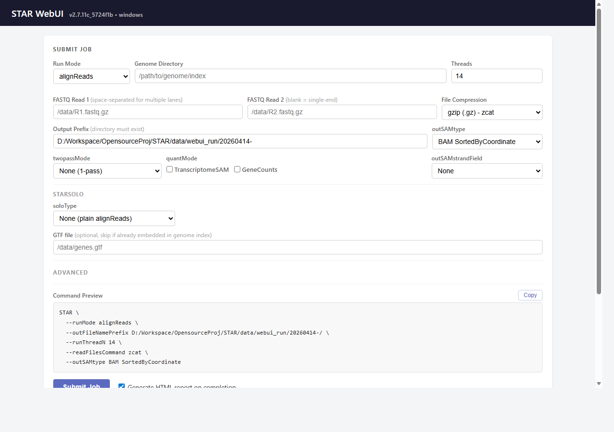
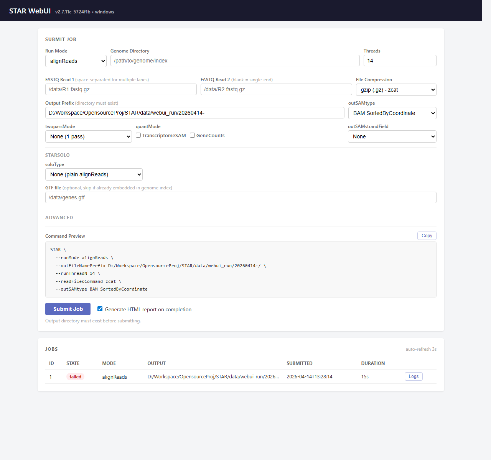

# Local Web UI

Start STAR-Cross with an output prefix:

```sh
STAR --runMode webui --webuiPort 8080 --outFileNamePrefix results/
```

On Windows, use `STAR.exe`. Open `http://127.0.0.1:8080` in a browser.
Submitted paths refer to files on the machine running STAR-Cross, not to files
on a remote browser's computer.

## Submit a job

Select `alignReads`, `genomeGenerate` or `soloCellFiltering`, supply the input
and output paths, and check the generated command before submitting.
STARsolo presets provide starting barcode/UMI settings; verify that the preset
matches the library chemistry and read layout.



The job table shows queue state, timestamps and output locations. Completed
jobs expose logs and available reports/artifacts. A completed process still
needs output inspection and any validation required by your analysis.



## Server options

| Option | Default | Meaning |
| --- | --- | --- |
| `--webuiPort` | `8080` | Listening port |
| `--webuiHost` | `127.0.0.1` | Bind address |
| `--outFileNamePrefix` | Supply explicitly | Initial output prefix in the form |

Keep the default loopback address for local use. Jobs run with your account and
can execute commands (for example through `--readFilesCommand` in extra
arguments), so the server only accepts requests from its own page:

- the `Host` header must name the loopback server, which defeats DNS rebinding;
- a request carrying a different `Origin` is rejected, as is any `POST` that is
  not `Content-Type: application/json`, so other websites cannot submit jobs;
- `runMode` must be `alignReads`, `genomeGenerate` or `soloCellFiltering`.

Binding to a non-loopback address prints a one-time URL with a random token
(`/?token=...`). Opening it sets a same-site cookie; API clients send the token
in an `X-STAR-WebUI-Token` header. This is access control, not TLS or a
secure-public-hosting configuration: use it only on trusted networks.

## Jobs and logs

One job runs at a time; up to nine more wait in a queue that advances even when
no browser is open. Queued and running jobs can be cancelled; cancelling stops
the whole STAR process group (including read decompression helpers on Linux and
macOS). Each job's console output is written to `WebUI_console.log` under its
output prefix and is included in the log view.
